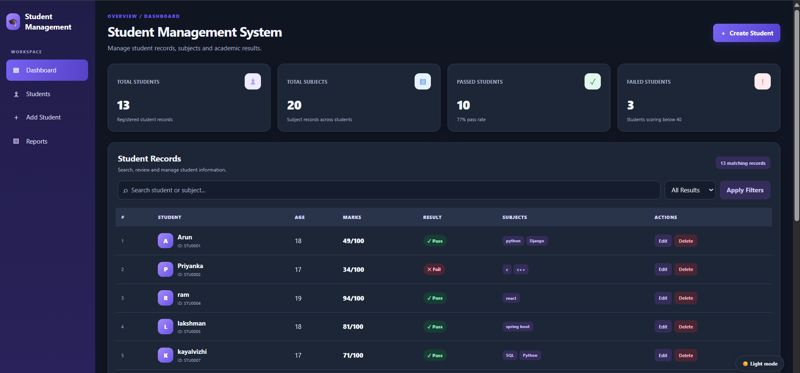
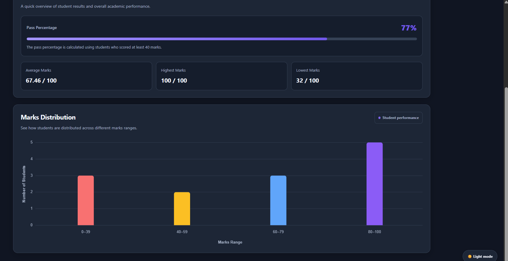
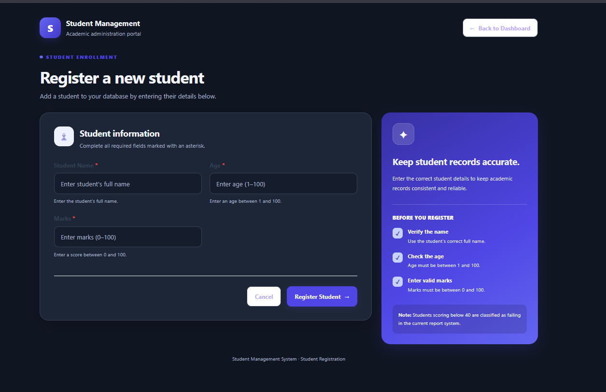

# Django Learning Journey

A hands-on Django project documenting my daily learning journey in Python web development. I built a **Student Management System** while learning Django fundamentals, database operations, forms, validation, ORM relationships, CRUD operations, reporting, and frontend UI enhancements.

**GitHub Repository:** [django-Learning](https://github.com/jaswantmp/django-Learning)

## Project Overview

The Student Management System is a Django web application for managing student records and their associated subjects. It includes student CRUD operations, form validation, subject management, student result calculation, search and filtering, performance reports, and CSV export.

The project was developed incrementally, applying the concepts learned each day to a practical web application.

## Screenshots

### Student Dashboard



### Student Analytics and Reports



### Student Registration




## Features

- **Student Management:** Create, view, update, and delete student records.
- **Form Validation:** Validate student names, ages, and marks using Django ModelForms.
- **Student Results:** Display Pass or Fail based on student marks.
- **Django Admin:** Manage student and subject records through the admin interface.
- **Admin Search and Filters:** Search student names and filter records.
- **Subject Management:** Associate subjects with students using `ForeignKey` relationships.
- **Subject CRUD:** Add, update, and delete subjects from the student edit page.
- **Duplicate Prevention:** Prevent duplicate subject names for the same student.
- **Django ORM:** Filter, sort, exclude, and retrieve database records.
- **Success Messages:** Display feedback after successful operations.
- **Responsive Dashboard:** Display student records, statistics, and search functionality.
- **Student Reports:** Display student statistics and marks distribution using charts.
- **CSV Export:** Export student records to a CSV file.
- **Automated Testing:** Practise testing Django models and views.
- **Modern UI:** Use a consistent interface with light and dark themes.
- **Theme Persistence:** Retain the selected theme using browser local storage.
- **Deletion Confirmation:** Provide a confirmation page before deleting a student.

## Technologies Used

- Python
- Django
- SQLite
- HTML
- CSS
- JavaScript
- Django Template Language
- Chart.js
- Git and GitHub

## Project Structure

```text
django-Learning/
├── manage.py
├── mysite/
│   ├── settings.py
│   └── urls.py
├── students/
│   ├── admin.py
│   ├── forms.py
│   ├── models.py
│   ├── tests.py
│   ├── urls.py
│   ├── views.py
│   ├── templates/
│   │   └── students/
│   │       ├── student_home.html
│   │       ├── student_register.html
│   │       ├── student_delete.html
│   │       └── student_reports.html
│   └── static/
│       └── students/
│           ├── css/
│           │   └── theme.css
│           └── js/
│               └── theme.js
├── templates/
├── screenshots/
│   ├── Dashboard.png
│   ├── Student_Registration.png
│   ├── Delete_Student.png
│   └── Student_Reports.png
├── daily-logs/
│   ├── Day-05/
│   ├── Day-06/
│   ├── Day-07/
│   ├── Day-08/
│   ├── Day-09/
│   ├── Day-10/
│   └── Day-11/
├── requirements.txt
├── .gitignore
└── README.md
```

*Note: This is a representative project structure. Keep the directory and file names consistent with the actual repository.*

## Setup and Installation

### 1. Clone the Repository

```bash
git clone https://github.com/jaswantmp/django-Learning.git
cd django-Learning
```

### 2. Create a Virtual Environment

```bash
python -m venv .venv
```

### 3. Activate the Environment

For Windows PowerShell:

```powershell
.venv\Scripts\Activate.ps1
```

### 4. Install Dependencies

```bash
python -m pip install -r requirements.txt
```

### 5. Apply Database Migrations

```bash
python manage.py migrate
```

### 6. Create an Admin Account

```bash
python manage.py createsuperuser
```

Follow the prompts to create your administrator account.

### 7. Start the Development Server

```bash
python manage.py runserver
```

Open the application in your browser:

- **Student Management:** [http://127.0.0.1:8000/students/](http://127.0.0.1:8000/students/)
- **Django Admin:** [http://127.0.0.1:8000/admin/](http://127.0.0.1:8000/admin/)

**Note:** The local SQLite database and its records are not included in the repository. Run the migrations and create your own data after setting up the project.

## Learning Progress

| Day | Topics Covered |
|---|---|
| Day 1 | Introduction to Django |
| Day 2 | Project setup and Django fundamentals |
| Day 3 | Apps, URLs, views, templates, and template context |
| Day 4 | Student Management System development |
| Day 5 | Django Forms, ModelForms, validation, and messages |
| Day 6 | CRUD operations and student table improvements |
| Day 7 | Django Admin customization and ORM queries |
| Day 8 | ForeignKey relationships and subject management |
| Day 9 | ORM relationships, uniqueness constraints, subject validation, and form validation |
| Day 10 | Dashboard UI improvements, student registration, deletion confirmation, and reports |
| Day 11 | Modern SaaS styling, light and dark themes, UI refinements, and final testing |

## Day 11 — Final Testing and UI Enhancements

The final day focused on improving the application's visual consistency and reviewing its existing functionality.

- Refined the application with a modern SaaS-inspired interface.
- Integrated light and dark themes across the relevant pages.
- Improved the student deletion confirmation page.
- Enhanced the student analytics and reports page.
- Reviewed typography, spacing, contrast, and readability.
- Reviewed the dashboard, registration, deletion, and reports interfaces.
- Used Django's automated testing tools during development.

## Key Concepts Learned

- Django project and app structure
- URL routing and view functions
- Rendering templates with context data
- Django Template Language loops and conditions
- Models and database migrations
- ModelForms and server-side validation
- CRUD operations
- Django Admin customization
- ORM filtering, sorting, exclusion, and aggregation
- ForeignKey relationships
- Database uniqueness constraints
- Django messages and CSRF protection
- Responsive HTML and CSS layouts
- JavaScript and browser local storage
- Light and dark theme implementation
- Data visualization with Chart.js
- CSV file generation and export
- Automated testing
- Git version control and GitHub

## Conclusion

This Django Learning Journey helped me progress from understanding Django fundamentals to building a functional Student Management System. Through hands-on development, I gained practical experience with database models, ORM queries, form validation, CRUD operations, subject relationships, reporting, CSV export, automated testing, and frontend design.

The final enhancements improved the application's visual consistency and usability while reinforcing the importance of testing and maintaining existing functionality. This project represents my practical learning experience with Django and provides a foundation for applying Python web development concepts to future projects.

## Author

**Jaswant MP**

- **GitHub:** [jaswantmp](https://github.com/jaswantmp)
- **LinkedIn:** [Jaswant MP](https://www.linkedin.com/in/jaswant-mp-a32b81378/)
- **LeetCode:** [jaswantmp](https://leetcode.com/u/jaswantmp/)

*This repository documents my hands-on learning journey and practical development experience with Django and Python web development.*
