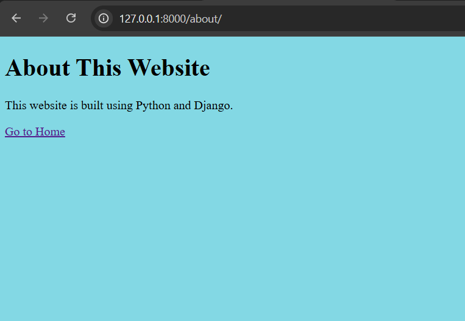
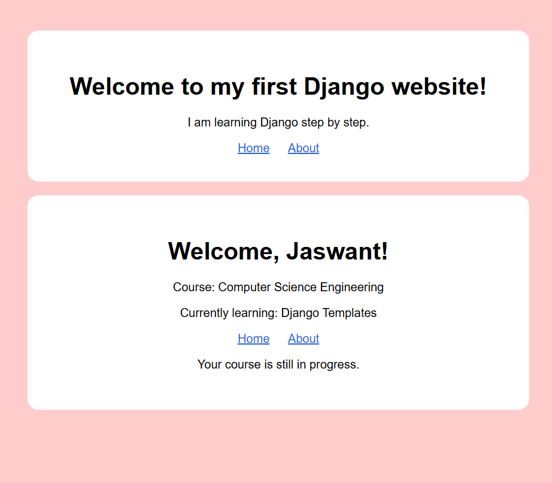
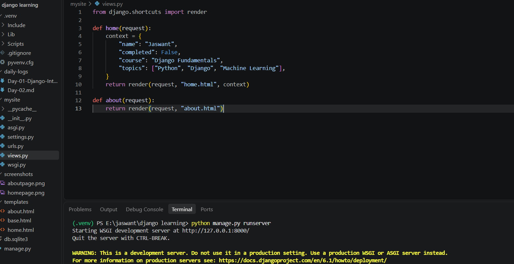

# Django Learning Log — Day 2

**Date:** 6 November 2026

**Topic:** Creating Multiple Pages and Implementing Template Inheritance in Django

## 1. Objective

To create an About page in Django, configure URL routing and views, connect HTML templates, and implement a shared layout using template inheritance.

## 2. Work Completed

### 2.1 Creating the About Page
- Created an `about.html` template inside the global `templates` directory.
- Added a heading and description to display information about the website.
- Created an `about()` view in `mysite/views.py` using Django's `render()` function.
- Configured the `/about/` URL in `mysite/urls.py` to connect to the About page view.
- Tested the page in the browser and verified that it loaded successfully.

### 2.2 Connecting URLs and Views
- Learned how Django URL patterns connect browser requests to view functions.
- Configured the Home page and About page routes.
- Understood how views return the appropriate HTML templates.

### 2.3 Configuring the Templates Directory
- Configured the global `templates` directory in `mysite/settings.py`.
- Learned how Django locates and renders HTML templates.

### 2.4 Implementing Template Inheritance
- Created `base.html` to maintain a common layout for multiple pages.
- Added shared navigation links and a footer.
- Used `` in `home.html` and `about.html`.
- Used `` and `` to customize each page.
- Resolved a template inheritance error by ensuring that `` was the first template tag in `home.html`.

### 2.5 Testing the Website
- Verified that the About page loaded at `/about/`.
- Verified that the Home page loaded at `/`.
- Checked that both pages displayed the shared layout and navigation links.

## 3. Output Screenshots

### Screenshot 1: About Page

### Screenshot 2: Home Page

### Screenshot 3: Project Structure

## 4. Key Learnings
- Creating multiple pages in Django.
- Connecting URL patterns with view functions.
- Rendering HTML templates.
- Configuring a global templates directory.
- Reusing common layouts through template inheritance.
- Identifying and resolving template errors.

## 5. Outcome

Successfully created and tested the About and Home pages in Django. Implemented template inheritance to reuse a common layout and navigation structure across both pages.

## 6. Next Steps
- Learn Django models and database integration.
- Understand CRUD operations.
- Create a simple application to store and display database records.