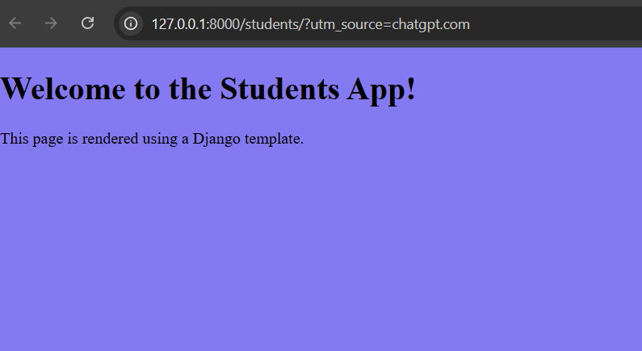
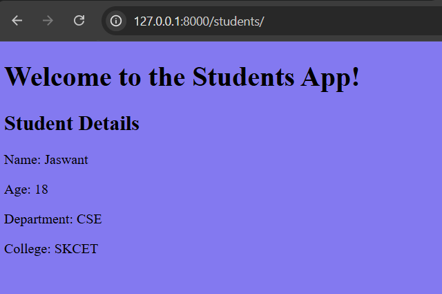
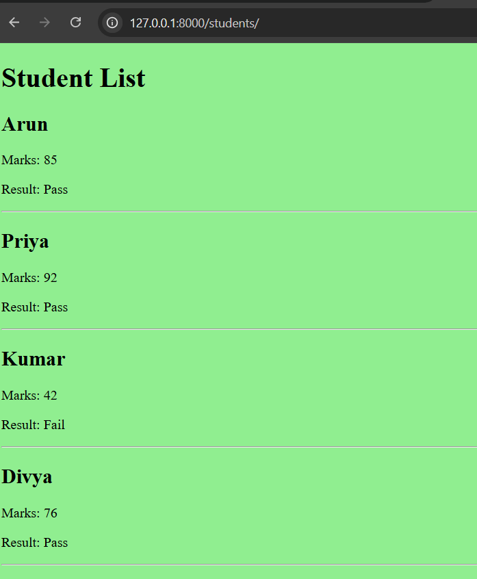

# Day 3: Django App and Templates

Today I learned how to create a Django app, connect URLs and views, render HTML templates, pass dynamic data, and use conditions and loops.

### Topics Covered
- Created and registered the `students` app.
- Configured app URLs using `urls.py` and `include()`.
- Created views using `HttpResponse()` and `render()`.
- Created an HTML template for the Students page.
- Passed dynamic data from `views.py` to HTML using context variables.
- Used Django `if/else` conditions to display Pass or Fail.
- Used `for` loops to display multiple students.

### Screenshot 1: Students Page

### Screenshot 2: Student List with Conditions and Loops

### Outcome

Successfully created a Django app and displayed dynamic student information using HTML templates, conditions, and loops.
