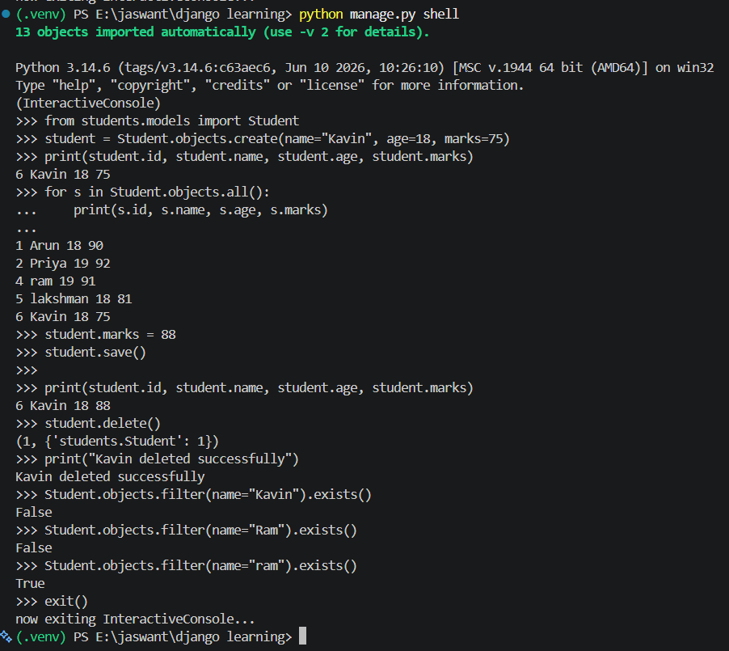
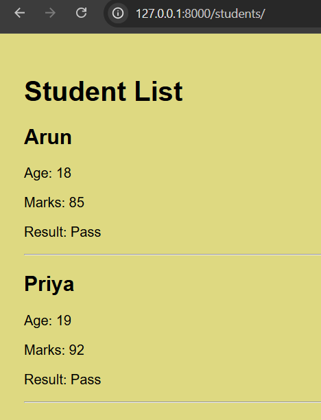
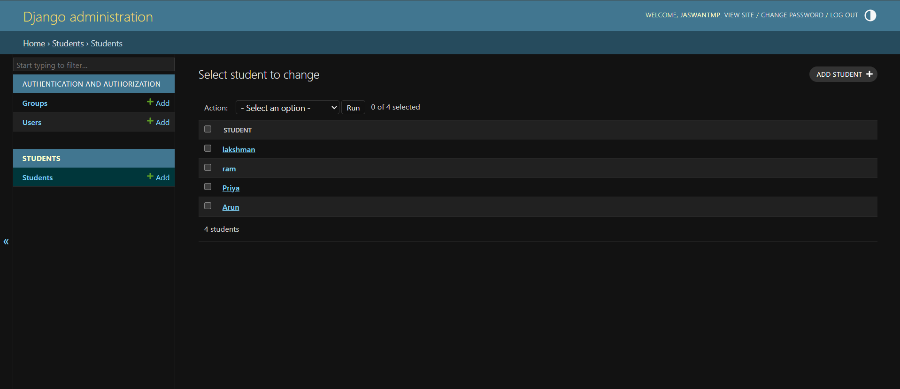

# Day 4: Django Models, Databases, and CRUD Operations

Today I learned how to create Django models, store student records in a database, retrieve data, display it on an HTML page, and manage records through the Django Admin dashboard.

### Topics Covered

- Created a `Student` model with name, age, and marks fields.
- Created database migrations using `makemigrations` and applied them using `migrate`.
- Used the Django shell to create and retrieve student records.
- Practised filtering records using `filter()`, `get()`, and `count()`.
- Learned how to update and delete database records.
- Connected the Student model to `students/views.py`.
- Displayed database records dynamically in `student_home.html` using Django template loops and conditions.
- Registered the Student model in Django Admin.
- Created a superuser and accessed the Django Admin dashboard to manage student records.

### Screenshot 1: CRUD Student Record

### Screenshot 2: Student List HTML Page

### Screenshot 3: Django Admin Dashboard

### Outcome

Successfully created a Django model, stored and managed student records in the database, displayed the records dynamically on an HTML page, and accessed the Django Admin dashboard to manage student information.

**Key Learning:** Django models connect Python code to database tables, views retrieve and process data, and templates display that data on webpages.