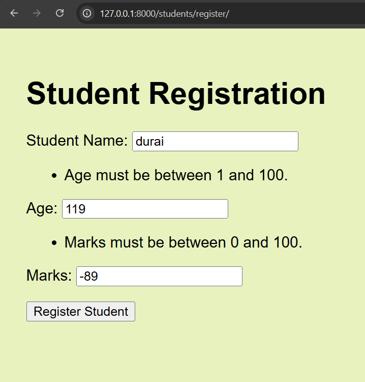
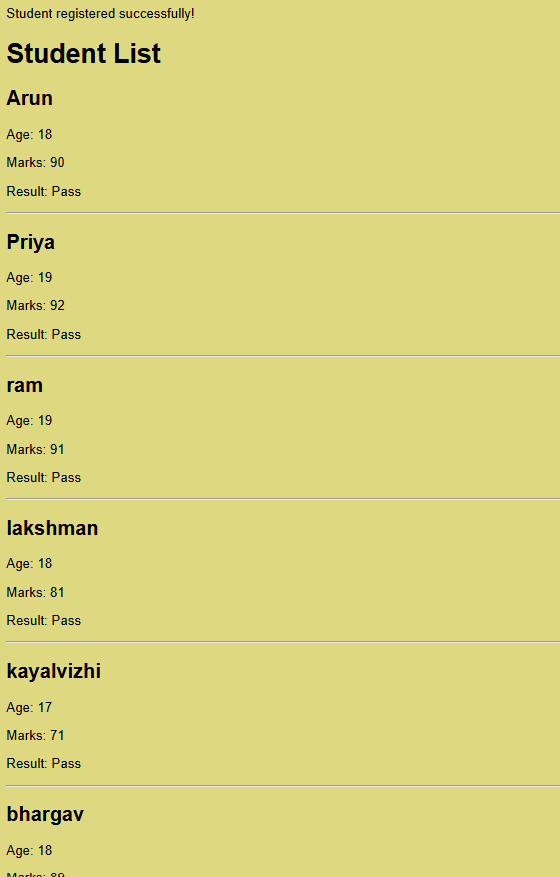

# Day 5 – Django Forms and Form Validation

## Topics Learned
- Created an HTML student registration form.
- Handled form submissions using the POST method.
- Used Django's CSRF token for form security.
- Saved student details to the database.
- Created a Django `ModelForm` using the `Student` model.
- Implemented custom validation for student name, age, and marks.
- Displayed validation errors in the form.
- Customized form field labels.
- Displayed success messages using Django's Messages Framework.

## Concepts Practiced
- `request.method`
- `request.POST`
- `form.is_valid()`
- `form.save()`
- `forms.ModelForm`
- `clean_name()`, `clean_age()`, and `clean_marks()`
- `messages.success()`
- `redirect()` and `render()`

## Screenshots

### 1. Form Validation
Shows the validation errors displayed when invalid student details are entered.

### 2. Successful Registration
Shows the success message after a student is registered successfully.

## Outcome
Successfully implemented student registration with database storage, input validation, customized labels, and a success message after registration.

## Next Steps
- Continue learning Django CRUD operations.
- Improve the form's HTML styling.
- Test the project setup using `README.md` and `requirements.txt`.
