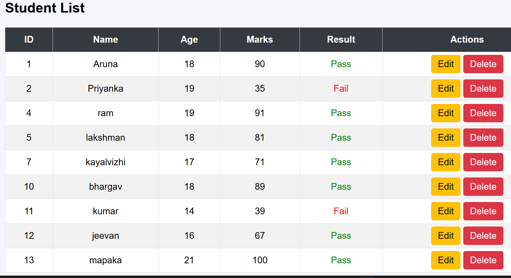
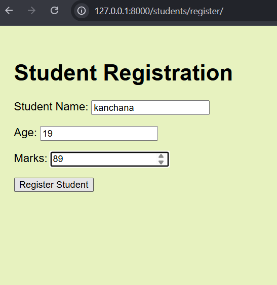
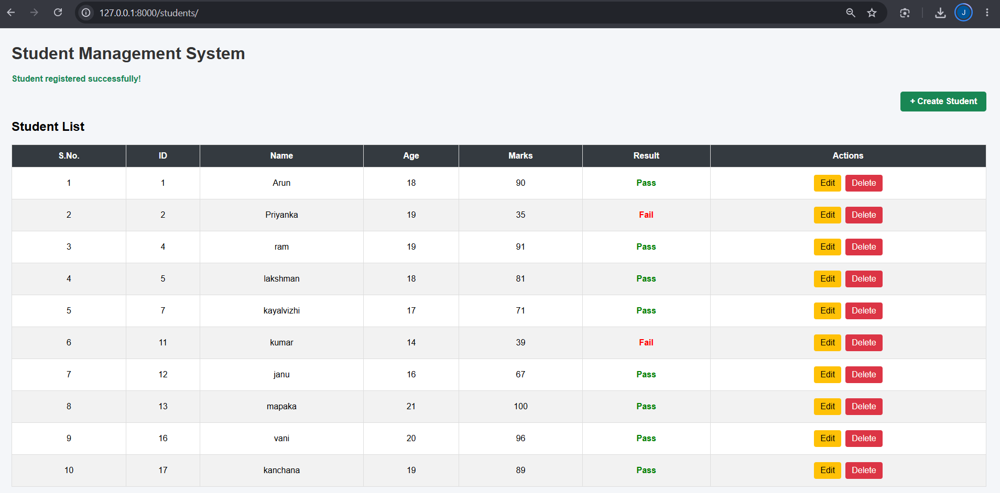
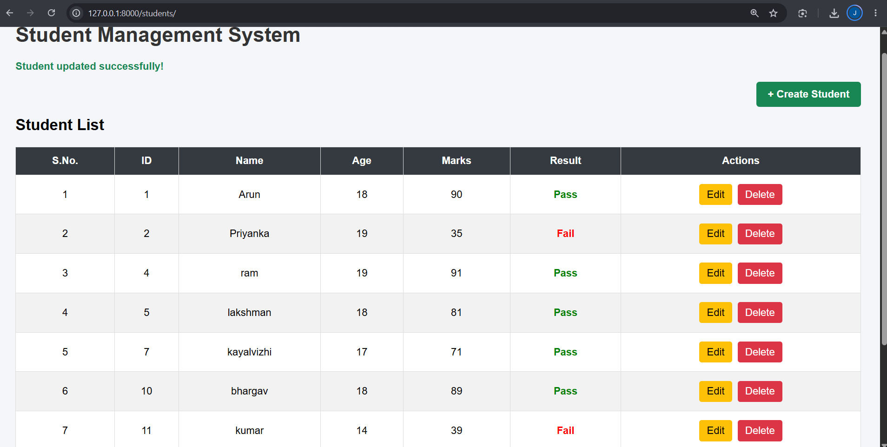
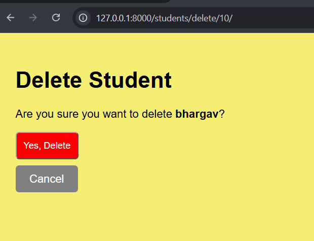
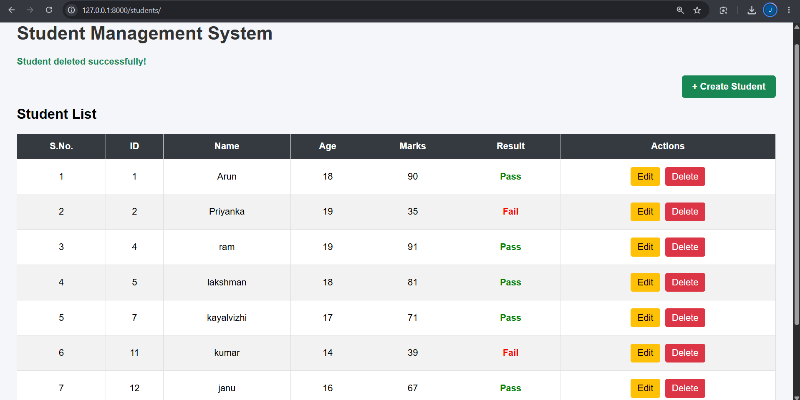

# Day 6 – Django CRUD Operations

## Topics Learned
- Implemented student update functionality using Django ModelForms.
- Retrieved existing student records using their IDs.
- Reused the registration form to edit student details.
- Implemented student deletion with a confirmation page.
- Used POST requests and CSRF tokens for safe form submissions.
- Added Create, Edit, and Delete navigation controls.
- Improved button styling using inline CSS.

## Screenshots

### 1. Student List

### 2. Student Registration

### 3. Registration Success

### 4. Update Student

### 5. Delete Confirmation

### 6. Delete Success

## Outcome
Successfully implemented and tested Create, Read, Update, and Delete (CRUD) operations in the Student Management System.
