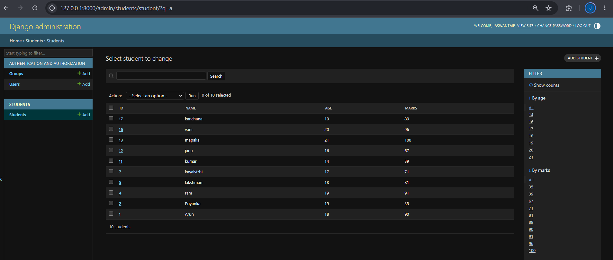
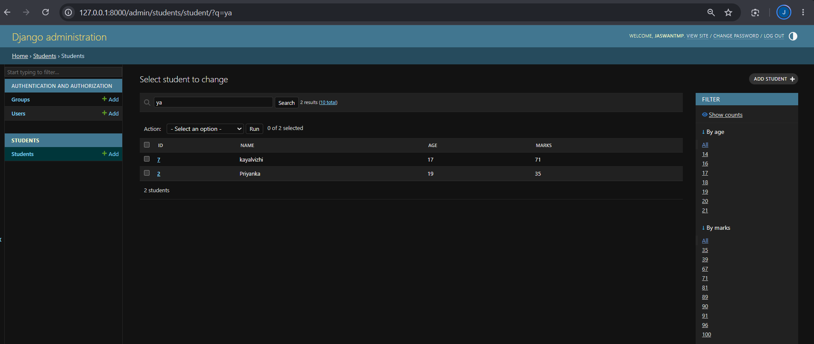
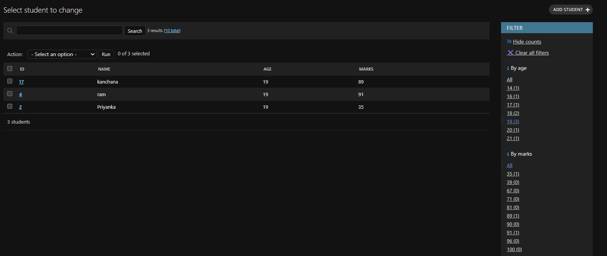
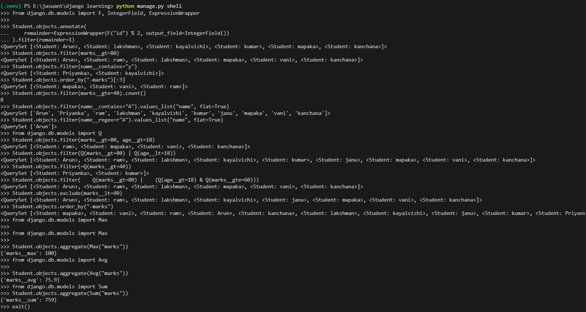

# Day 7 — Django Admin Customization and ORM Queries

## Objective
To customize the Django Admin interface and practise database filtering, sorting, conditional queries, and aggregate functions using Django ORM.

## Part 1: Django Admin Customization

### 1. Registering the Student Model
Customized the Django Admin interface to manage student records.

File: `students/admin.py`

```python
from django.contrib import admin
from .models import Student


@admin.register(Student)
class StudentAdmin(admin.ModelAdmin):
    list_display = ("id", "name", "age", "marks")
    search_fields = ("name",)
    list_filter = ("age", "marks")
```

### 2. Displaying Student Fields
Used `list_display` to show the following columns in the admin student list:
- ID
- Name
- Age
- Marks

### 3. Searching Student Records
Used `search_fields = ("name",)` to add a search box that searches student names.

### 4. Filtering Student Records
Used `list_filter = ("age", "marks")` to add sidebar filters for age and marks.

## Part 2: Django ORM Queries

### 1. Filtering Records

```python
Student.objects.filter(marks__gt=80)
Student.objects.filter(marks__gte=40)
Student.objects.filter(marks__lt=40)
Student.objects.filter(name__contains="A")
Student.objects.filter(name__icontains="A")
```

Practised filtering records using comparison and text lookups.

### 2. Filtering with Multiple Conditions

```python
from django.db.models import Q

Student.objects.filter(marks__gt=80, age__gt=18)
Student.objects.filter(Q(marks__gt=70) | Q(age__gt=20))
Student.objects.filter(~Q(marks__lt=40))
```

- Multiple keyword conditions in `filter()` combine using AND.
- `Q` objects allow combining conditions using `&` (AND), `|` (OR), and `~` (NOT).

### 3. Excluding Records

```python
Student.objects.exclude(age__gt=18)
```

Used `exclude()` to omit records that match a condition.

### 4. Sorting and Limiting Results

```python
Student.objects.order_by("age")
Student.objects.order_by("-marks")[:3]
Student.objects.order_by("-marks").first()
```

- `order_by("age")` sorts students by age in ascending order.
- `order_by("-marks")` sorts students by marks in descending order.
- `[:3]` limits the result to three records.
- `first()` retrieves the first matching object or `None`.

### 5. Aggregate Functions

```python
from django.db.models import Max, Avg, Sum

Student.objects.aggregate(Max("marks"))
Student.objects.aggregate(Avg("marks"))
Student.objects.aggregate(Sum("marks"))
Student.objects.count()
```

Practised calculating maximum marks, average marks, total marks, and the number of student records.

### 6. Finding Students with the Highest Marks

```python
Student.objects.filter(
    marks=Student.objects.aggregate(Max("marks"))["marks__max"]
)
```

This retrieves all students whose marks equal the highest marks in the database.

#
## Screenshots

### 1. Django Admin List Display



### 2. Django Admin Search



### 3. Django Admin Filters




### Django ORM Practice


### 4. Django ORM Practice




## Learning Outcomes

- Customized the Django Admin interface.
- Added search and sidebar filters to the admin student list.
- Practised filtering and excluding database records.
- Combined conditions using `Q` objects.
- Sorted and limited query results.
- Used aggregate functions to calculate database statistics.

## Next Steps

- Practise placement-style Django ORM questions.
- Learn `values()`, `values_list()`, `distinct()`, and advanced query combinations.
- Display filtered and sorted records on website pages.

**Status:** Day 7 completed — Django Admin Customization and ORM Query Practice.
