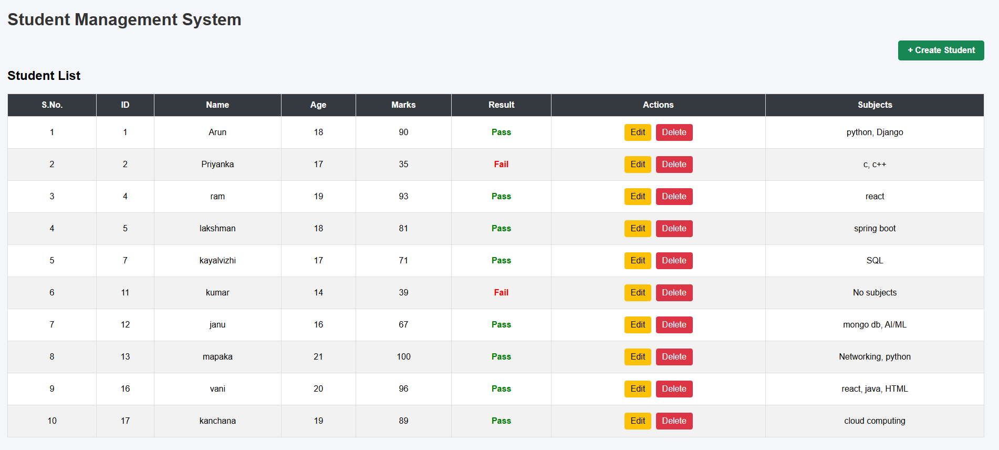
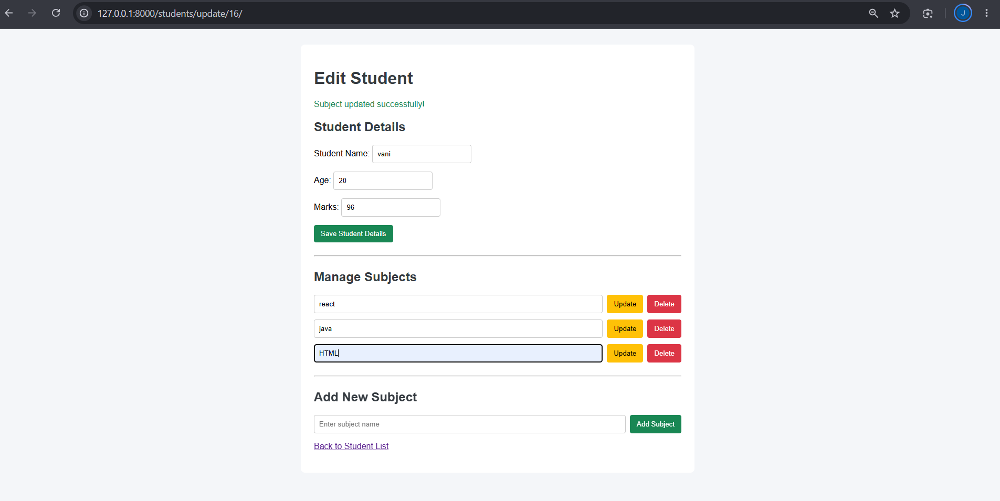
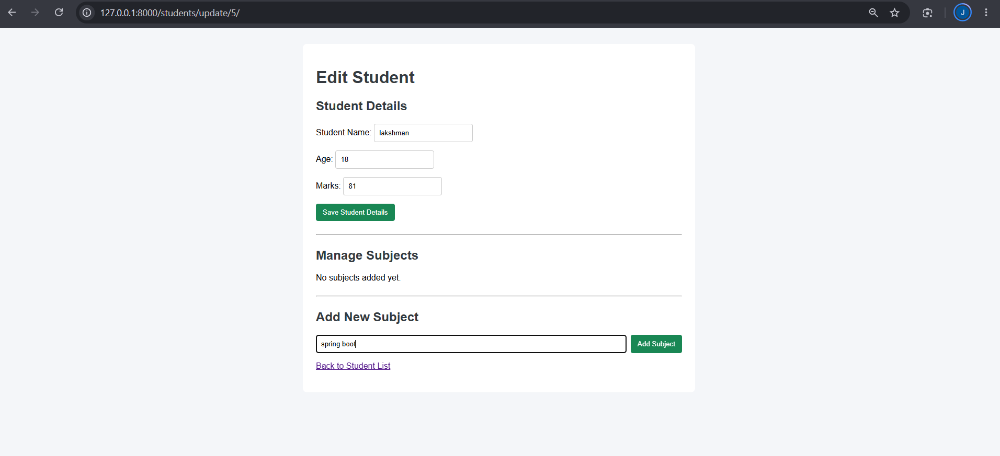
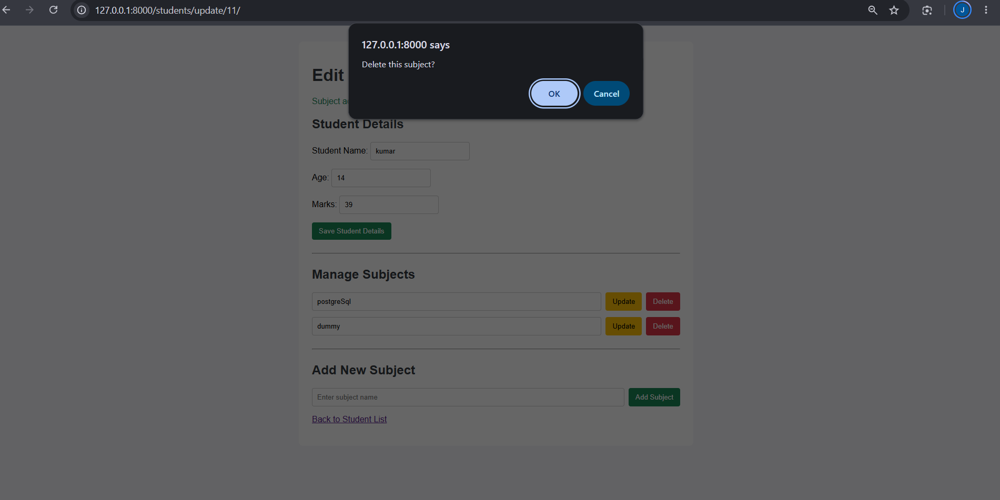

# Day 8 — Django ForeignKey Relationships and Subject Management

## Objective

Understand one-to-many relationships in Django and associate multiple subjects with a student. Extend the Student Management System to manage subjects on the existing student edit page.

## 1. Created the Subject Model

Added a `Subject` model in `students/models.py`.

```python
class Subject(models.Model):
    name = models.CharField(max_length=100)
    student = models.ForeignKey(
        Student,
        on_delete=models.CASCADE,
        related_name="subjects"
    )

    def __str__(self):
        return self.name
```

### Concepts Learned

- `CharField`: Stores the subject name.
- `ForeignKey`: Connects a subject to a student.
- `on_delete=models.CASCADE`: Deletes related subjects when their student is deleted.
- `related_name="subjects"`: Allows access to related subjects through `student.subjects.all()`.
- `__str__()`: Returns the subject name when displaying the object.

## 2. Database Migrations

Created and applied migrations for the new model.

```bash
python manage.py makemigrations students
python manage.py migrate
```

## 3. Django Admin Configuration

Registered the Subject model in `students/admin.py` to display subject IDs, names, and associated students, with search and filtering options.

## 4. Accessing Related Objects

Practiced retrieving subjects associated with a student:

```python
student.subjects.all()
```

Retrieved the student associated with a subject:

```python
subject.student
subject.student.name
```

These operations demonstrate how Django follows ForeignKey relationships in both directions.

## 5. Displaying Subjects in the Student List

Used the related manager in the student template:

```django

    {{ subject.name }}

    No subjects

```

Also learned that `prefetch_related("subjects")` can reduce repeated database queries when displaying subjects for multiple students.

## 6. Subject Management on the Student Edit Page

Extended the existing student edit page to manage student details and subjects together.

The intended functionality includes:

- Displaying the existing student name, age, and marks.
- Listing subjects already associated with the student.
- Adding new subjects.
- Updating existing subject names.
- Deleting individual subjects with confirmation.
- Returning to the same student's edit page after a subject operation.

The subject-management view uses the selected student to scope subject updates and deletions.

## 7. Screenshots

Save screenshots of the working application in `daily-logs/Day-08/screenshots/`.

### Student Edit Page



### Edit Existing Subjects



### Add a Subject



### Delete a Subject



## Learning Outcomes

- Understood one-to-many relationships.
- Created a ForeignKey relationship between Student and Subject.
- Practiced accessing related objects using Django ORM.
- Learned how `related_name` works.
- Used `prefetch_related()` for more efficient related-object retrieval.
- Integrated subject-management controls into an existing edit page.

## Next Steps

- Test all subject operations.
- Add validation and prevent duplicate subjects where appropriate.
- Improve the styling of the student edit page.
- Add automated tests for subject creation, updates, and deletion.
