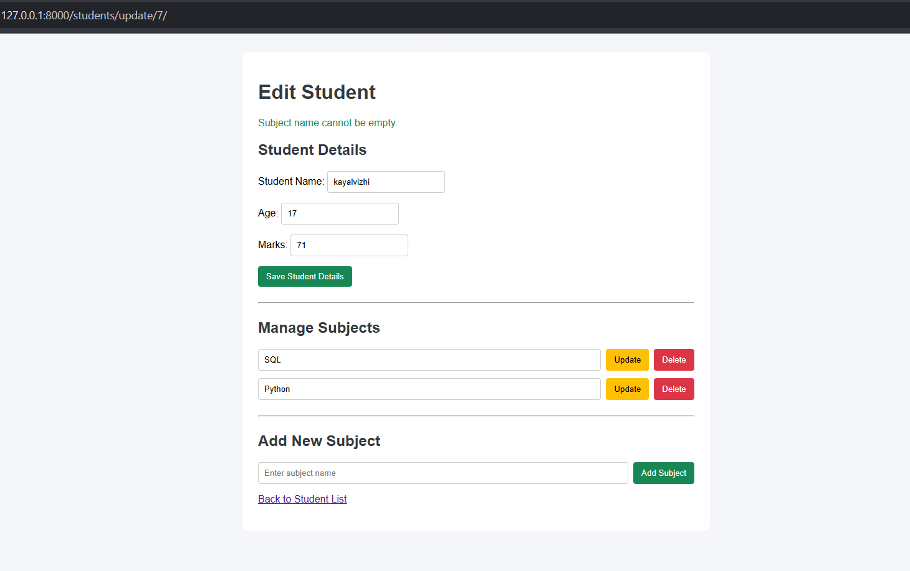
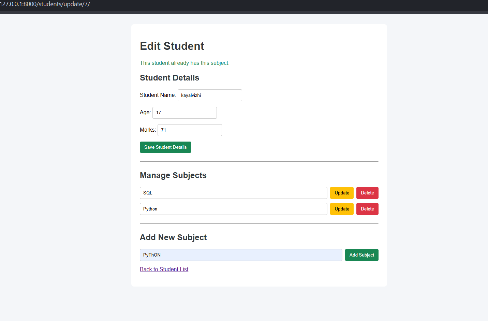
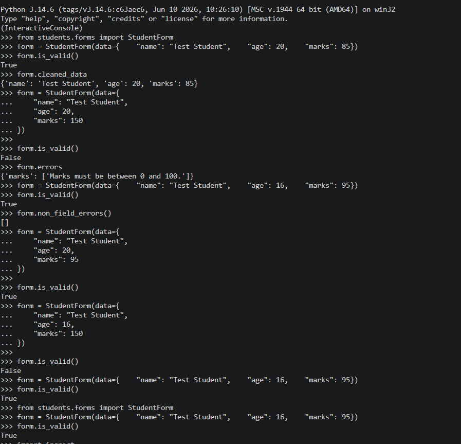
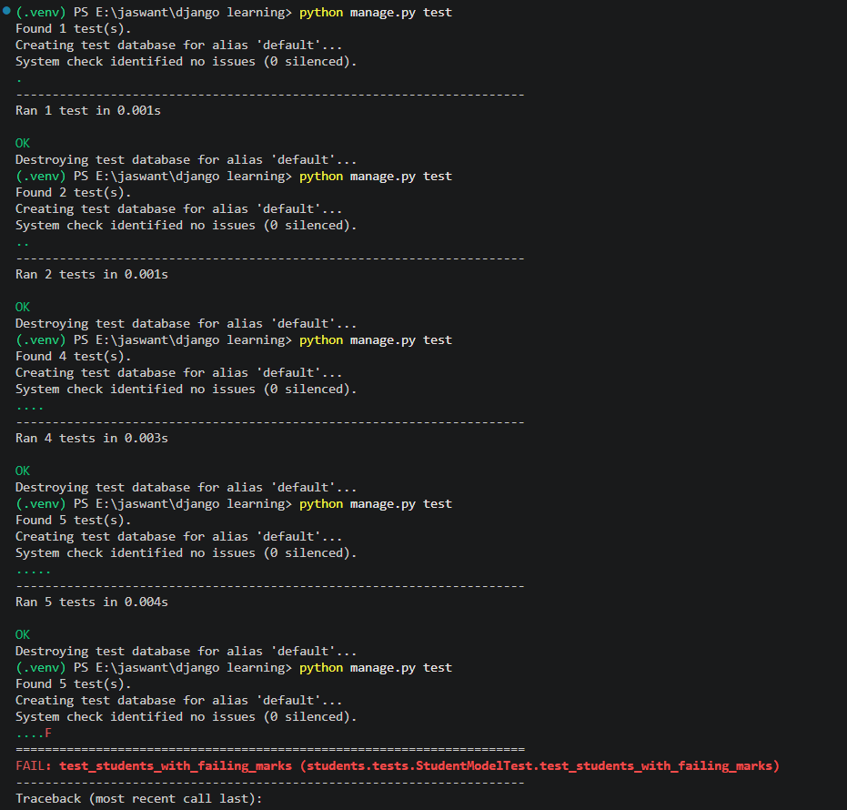

# Django Learning Log — Day 9

**Date:** 17 November 2026  
**Topics:** Django ORM, Model Relationships and Validation

## 1. What I Learned

- Practised working with student records using Django ORM.
- Learned how to create and filter database records.
- Created a `Subject` model related to the `Student` model using `ForeignKey`.
- Understood `on_delete=models.CASCADE` and `related_name`.
- Added a uniqueness constraint for subject names belonging to the same student.
- Improved subject validation to prevent empty names and duplicate subjects during addition and editing.
- Explored Django form validation and tested validation errors.

## 2. Screenshots

### Student Name Cannot Be Empty

### Duplicate Subject Validation

### Form Validation and ORM

### Tests in Terminal

## 3. Important Concepts

- **ORM:** Interacts with the database using Python objects and query methods.
- **ForeignKey:** Establishes a relationship between two models.
- **CASCADE:** Deletes related subject records when their associated student is deleted.
- **UniqueConstraint:** Prevents duplicate combinations of the constrained fields.
- **Validation:** Checks submitted data before saving it.

## 4. Next Steps

- Continue practising Django forms and validation.
- Test student views and form submissions.
- Run the automated test suite and resolve any failures.
- Continue the Django learning plan with the next lesson.

