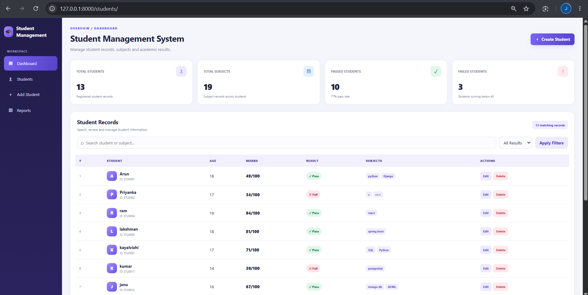
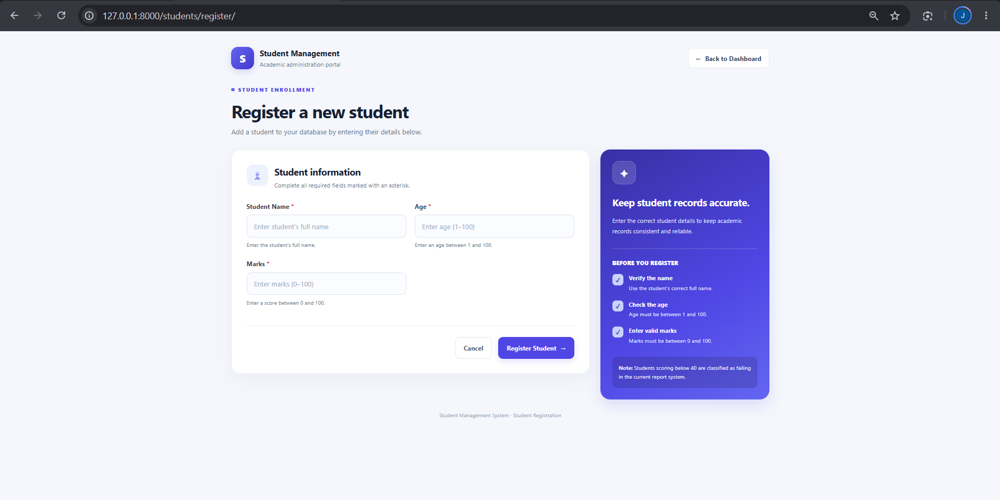
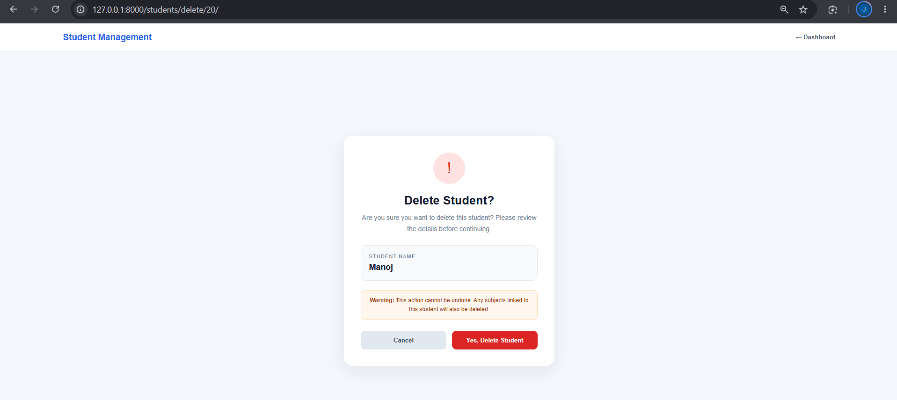
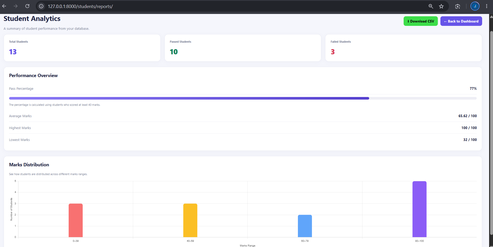

# Day 10 – Django Student Management System

**Date:** 18 November 2026

## Work Completed

Today, I continued developing my Django Student Management System and improved the user interface of its main pages.

1. **Dashboard Page:** Reviewed the student dashboard, including student records, search functionality, and statistics.
2. **Student Registration Page:** Created a modern registration interface with form fields, input validation, and a responsive layout.
3. **Delete Student Page:** Designed a confirmation page with student details, warning messages, and Delete and Cancel buttons.
4. **Reports Page:** Reviewed the reports dashboard displaying student statistics and marks distribution using a chart.

## Screenshots
### Dashboard Page

### Student Registration Page

### Delete Student Page

### Student Reports Page

## Learning Outcome

Learned to improve Django templates using HTML and CSS, create user-friendly interfaces, handle form validation, design deletion confirmation pages, and present student data through reports and charts.

## Tomorrow's Work

1. Improve the overall consistency of the website's design and responsiveness.
2. Test student registration, updating, and deletion functionalities.
3. Verify the search, filtering, and CSV export features.
4. Test the reports page and check the accuracy of displayed statistics and charts.
5. Identify and fix any errors or usability issues in the application.