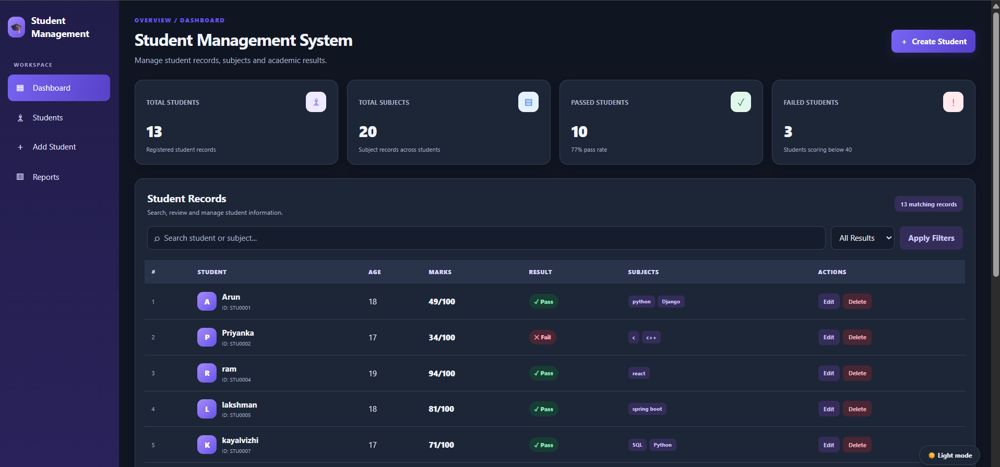
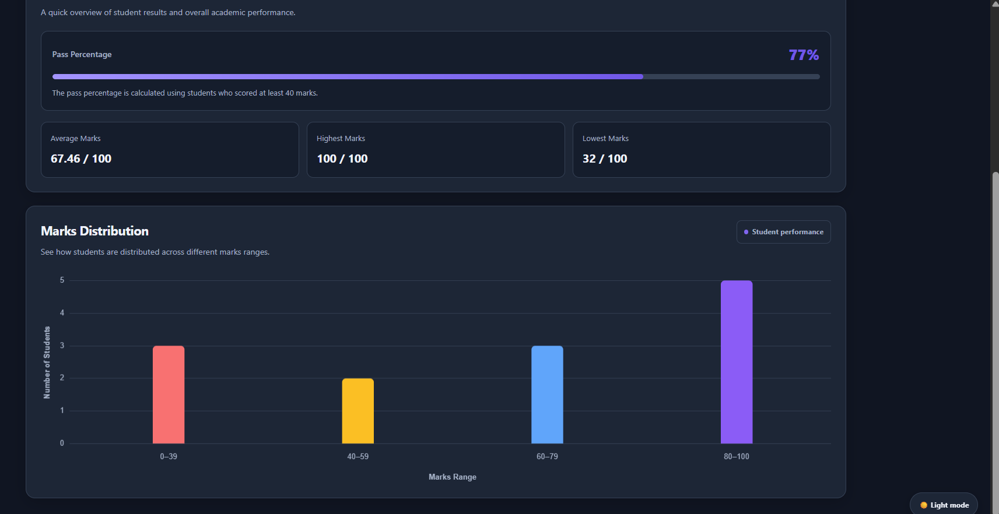
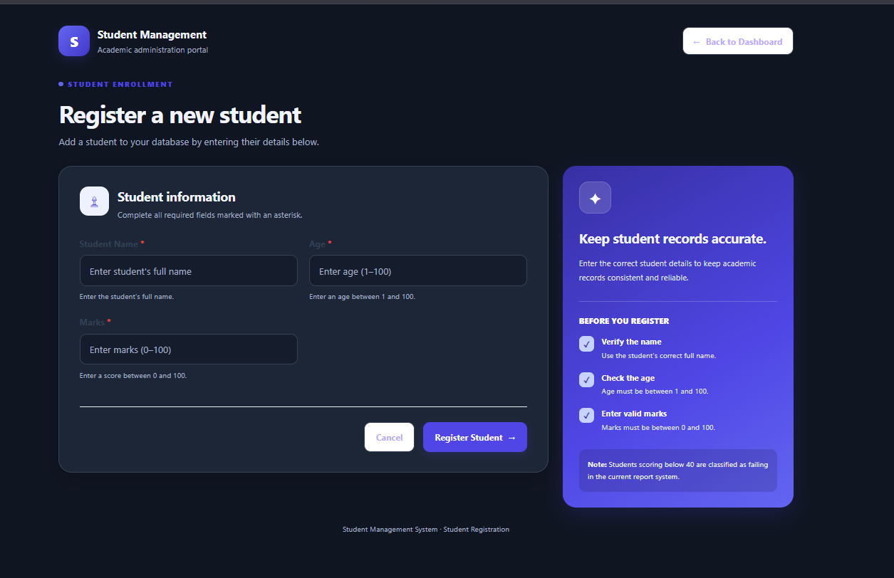

# Day 11 — Django Student Management System UI Enhancement and Final Testing

## Objective

Enhance the visual design, readability, and responsiveness of the existing Django Student Management System using a modern SaaS design with dark navy backgrounds, purple accents, and consistent light and dark themes. Perform final testing while preserving existing functionality.

## 1. Modern SaaS Theme Enhancement

Updated `students/static/students/css/theme.css` to improve the overall appearance of the application.

### Improvements Made

- Introduced consistent theme colours using CSS variables.
- Improved dark navy backgrounds and purple accents.
- Enhanced contrast between backgrounds, cards, borders, and text.
- Improved the appearance of panels, tables, search fields, and form controls.
- Refined the theme toggle button.
- Improved responsive styling for smaller screens.

### Concepts Learned

- CSS custom properties and theme variables.
- Light and dark theme styling.
- CSS selectors and specificity.
- Responsive design and media queries.
- Hover effects and visual consistency.

## 2. Student Analytics and Reports Page

Enhanced `students/templates/students/student_reports.html` with a cleaner analytics layout.

### Improvements Made

- Redesigned the student summary cards.
- Improved the visual presentation of total, passed, and failed student counts.
- Enhanced the pass-percentage progress bar.
- Organized average, highest, and lowest marks into clear metric cards.
- Improved the marks-distribution chart using Chart.js.
- Increased font sizes for better readability.
- Improved chart-axis labels, spacing, and colour contrast.
- Preserved the CSV download and dashboard navigation links.
- Updated chart colours when switching between light and dark themes.

### Concepts Learned

- Displaying Django template variables.
- Passing JSON data from Django templates to JavaScript.
- Configuring Chart.js axes, tooltips, and colours.
- Using `MutationObserver` to detect theme changes.
- Improving data visualization and readability.

## 3. Student Deletion Confirmation Page

Enhanced `students/templates/students/student_delete.html` to provide a clearer and more consistent confirmation interface.

### Improvements Made

- Redesigned the deletion confirmation card.
- Improved the warning icon and student information section.
- Increased font sizes and spacing for readability.
- Improved the warning message about deleting linked subjects.
- Refined the Cancel and Delete Student buttons.
- Improved light and dark theme contrast.
- Added responsive styling for mobile screens.
- Preserved the existing Django POST form and CSRF protection.

### Concepts Learned

- Styling confirmation interfaces.
- Improving destructive-action warnings.
- Using CSS variables for consistent styling.
- Preserving Django form submission and security mechanisms.
- Applying responsive layouts.

## 4. Theme Integration

Integrated the shared theme stylesheet and JavaScript across the relevant pages.

The theme functionality supports:

- Switching between light and dark modes.
- Saving the selected theme in browser `localStorage`.
- Restoring the saved theme when revisiting the application.
- Updating the reports chart colours when the theme changes.
- Maintaining readable text and component contrast.

## 5. Final Testing and Verification

Performed final checks of the enhanced interface and existing functionality.

### Testing Checklist

- Verified the dashboard appearance in light and dark modes.
- Checked the reports page layout and font readability.
- Reviewed chart labels and theme-dependent chart colours.
- Checked the student deletion confirmation layout.
- Reviewed navigation links and CSV download functionality.
- Checked responsive styling for smaller screens.
- Preserved existing Django views, models, URLs, and database relationships.

## 6. Screenshots

Save the screenshots in `daily-logs/Day-11/screenshots/`.

### Student Dashboard

### Student Analytics and Reports

### New Student Registration Page

## Learning Outcomes

- Improved the UI design of an existing Django application.
- Applied a consistent Modern SaaS visual style.
- Improved readability and contrast in light and dark modes.
- Enhanced reports and data visualization using Chart.js.
- Practiced responsive CSS and component styling.
- Improved the presentation of destructive actions and confirmation forms.
- Learned to enhance an existing application while preserving its core functionality.

## Conclusion

Completed the UI enhancement and final testing phase of the Django Student Management System. Improved the dashboard theme, analytics presentation, reports readability, and student deletion confirmation interface while retaining the existing application structure and functionality.